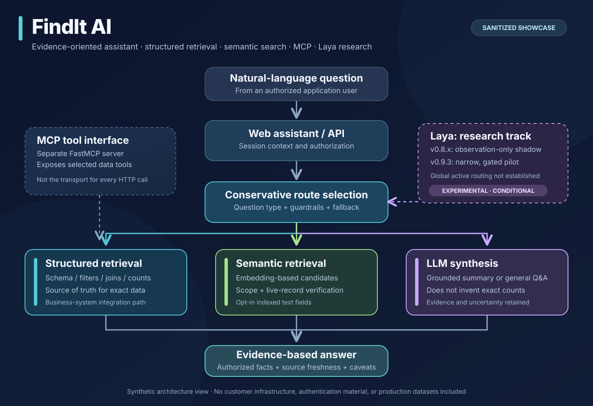
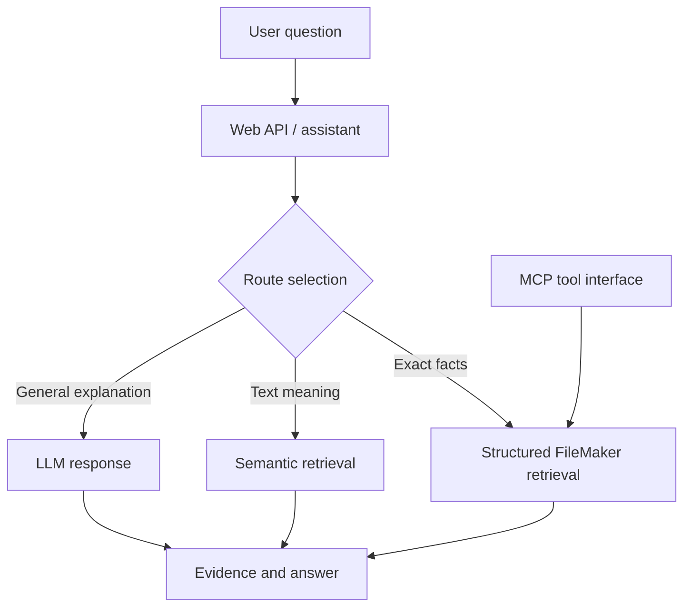

# FindIt AI — Enterprise Assistant Architecture Showcase

**An applied AI assistant combining structured retrieval, semantic search, an MCP interface, and the Laya decision-model research track. FileMaker is the first business-system integration documented here.**

This repository demonstrates the engineering patterns behind a project I began as a personal prototype and subsequently adapted for business workflows. It is designed as a **public, synthetic-data technical showcase**. The runnable examples here are independently reconstructed reference implementations—not a source dump of client deployments, not a live FileMaker integration, and not proof that every experimental feature was activated in production.

## What problem does it address?

Business users ask questions that require different retrieval strategies:

- **Structured:** “How many open tasks are assigned to me?” needs exact filters, joins, and counts.
- **Semantic:** “Find discussions about delayed approvals” needs meaning-based search over text records.
- **General:** “Explain how task dependencies work” may need an LLM, not a database query.

Laya is my decision-model track for selecting a suitable answer path. Early shadow mode observes queries without changing answers; controlled experiments evaluate model-driven dispatch behind explicit activation and fallbacks.

## Architecture



*The visual distinguishes the direct assistant data path, the separate MCP tool server, and Laya's experimental status.*



The MCP server is a separate tool-facing integration. In the reviewed code, the web API also has a **direct FileMaker data path**; the diagram does **not** claim all HTTP requests are transported over MCP.

## Short video walkthrough

[Watch the 38-second FindIt AI walkthrough](media/findit-ai-synthetic-walkthrough.mp4)

The video is an intentionally **synthetic, silent walkthrough** of the architecture and the public reference demo output. It is not a capture of the private production console or a demonstration against real customer systems. See [how the video was made](media/README.md) for reproducibility and privacy boundaries.

## Evidence-backed implementation scope

| Capability | What the reviewed implementation establishes | Disclosure |
| --- | --- | --- |
| FileMaker structured queries | Dynamic layout/schema discovery, rule-guided selection and deterministic query/report paths | Client schemas and authentication omitted |
| MCP integration | Separate FastMCP tool server exposing legacy contact tools and dynamic assistant/search tools | MCP transport distinct from web API |
| Semantic retrieval | Opt-in FileMaker text indexing and cosine-ranked retrieval with live-record content verification | Deployed scope was limited; later expansions were staged |
| Embedding model | EmbeddingGemma-based semantic track with 768-dimensional embeddings | Model/runtime assets not redistributed |
| Laya v0.8.x | Shadow observations; **does not override routing** | Research/telemetry mode |
| Laya v0.9.3 | Conditional, narrowly scoped read-only project-analysis pilot with fallback | Global routing/activation **not established** |
| Async analysis | Bounded background jobs and a persisted job-store implementation | No performance or availability SLA claimed |
| Team deployment console | Demo UI supports per-server configuration, testing, rules and logs | Real client endpoints and live deployment secrets excluded |

## Explore the safe reference code

```bash
python3 -m unittest discover -s tests -v
python3 -m examples.demo
```

Only Python standard-library modules are required for these exercises. The included vector example accepts supplied embeddings; the demo uses illustrative vectors, **not** the production EmbeddingGemma model. The MCP adapter is a conceptual optional integration example; it does not contact a remote database.

| File | Demonstrates |
| --- | --- |
| `findit_showcase/decision.py` | Explicit intent classification and conservative route selection |
| `findit_showcase/structured.py` | Parameterized, allowlisted SQLite queries on synthetic tasks |
| `findit_showcase/semantic.py` | Cosine similarity, collection scope and fresh-record hash validation |
| `examples/demo.py` | Testable structured and semantic retrieval workflow |
| `examples/mcp_tools.py` | Optional FastMCP tool registration against the synthetic dataset |

## Design and engineering notes

- [Architecture and boundaries](docs/architecture.md)
- [Laya: observed vs experimental behavior](docs/laya.md)
- [Semantic retrieval and provenance](docs/semantic-retrieval.md)
- [Security and responsible-publication controls](docs/security.md)
- [Testing, limitations and reproducibility](docs/evaluation.md)
- [Release checklist](docs/release-checklist.md)
- [Rebuild the sanitized video walkthrough](media/README.md)

## What is intentionally not included

Production source archives, `.env` files, service/API tokens, SSH credentials, customer records, FileMaker XML exports, private rules, database snapshots, deployment logs, unredacted team demos, hostnames/IP addresses, and transcripts. Actual client implementations may differ from the reference code.

## Attribution and status

**Project/design:** Shubham Gopale. Original product name: **FindIt AI**. The examples in this repository were reconstructed for safe public explanation from a private implementation review. This is a portfolio demonstration, not a commercial distribution or an endorsement by any customer or employer.

**License:** Not yet assigned pending the final public-release and ownership review. No permission to reuse the source is implied by repository visibility.

