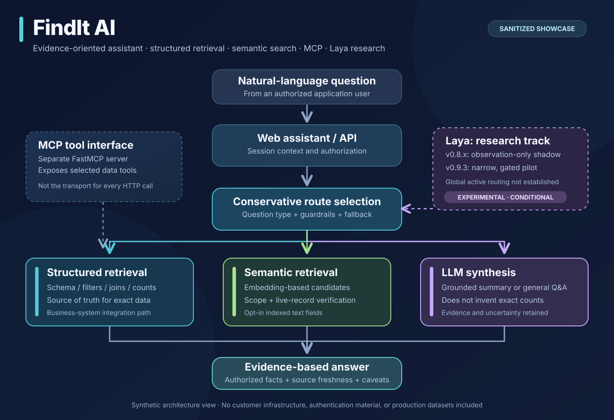

# System architecture and integration boundaries

The diagram is a **conceptual, sanitized representation** of source-reviewed components and boundaries. The public runnable reference code uses synthetic records and illustrative embeddings; it does not connect to client systems.

The private project brings a natural-language interaction layer to FileMaker-backed business applications. These are the components distinguished during the source review:

1. **API:** A web-facing assistant receives natural language, session context, and authenticated application requests.
2. **Structured retrieval:** FileMaker schema/layout metadata and explicitly configured business rules direct exact database queries, filtering, aggregation, and reporting.
3. **Semantic retrieval:** An independent index of selected text fields serves meaning-based candidate searches. Candidates are checked against live source records before use in answers.
4. **LLM synthesis:** A language model may synthesize context-backed answers or handle general queries. It is not the source of truth for exact database counts.
5. **MCP:** A separate FastMCP server publishes tool interfaces for certain FileMaker operations. The HTTP API can also call internal data-access modules directly.
6. **Laya:** A decision-model research/controlled-dispatch track explores classification and routing. The source includes observation-only and gated-pilot implementations, not verified universal production dispatch.
7. **Deployment console:** A team-facing console for configuring, checking and deploying tenant-specific assistants, with server-specific rules and test surfaces.

## Source-of-truth principle

`Natural-language question -> route -> authorized retrieval -> evidence check -> response`

When reporting a number, a database query should provide the value. When finding related concepts, semantic search can propose records, but authorization and current source content must be verified before presenting them. A generative answer should disclose its evidence and not imply unsupported certainty.

## Operational caution

No network access, FileMaker credentials, client database, deployment endpoint, or external model is required to execute this public showcase. The repository does not claim certification, a security audit, benchmark superiority, or client-wide deployment of experimental Laya stages.

